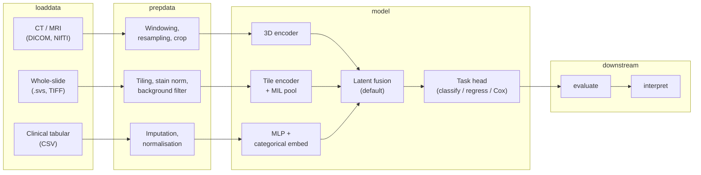

# kalecancer architecture

The design of the `kalecancer` package and the reasoning behind it. Much of this
document was written before implementation and remains in future tense; the table
below records what is now built. Items marked **Open question** are unresolved.

| Area | State |
| --- | --- |
| WSI loading, cohort matching, patient-level splitting | Implemented |
| Attention MIL encoder | Implemented |
| Cox head, loss, and survival metrics | Implemented: a hand-rolled Efron-corrected Cox loss and C-index, scikit-survival for the IPCW metrics |
| Attention interpretation | Implemented |
| Multimodal fusion (early, late, hybrid) | Implemented, with a multimodal cohort loader |
| Binary classification alongside survival | Implemented, as a swappable `PredictionTask` |
| CT/MRI encoders | Planned |

For usage rather than rationale, see the [quickstart](quickstart.md), the
[WSI pipeline reference](../examples/hancock_wsi_survival/) and the
[fusion reference](multimodal_fusion.md).

---

## Scope

The initial clinical focus will be **head and neck cancer (HNC)**.

The intended use case is **treatment decision support**, not diagnosis. Models will aim to inform clinicians about expected outcomes and relative risk under different treatment contexts — not to replace histopathological or radiological diagnosis.

Planned outcome targets:

| Outcome | Definition | Priority |
| --- | --- | --- |
| **Overall survival (OS)** | Death from any cause | **v1 primary target** — death is unambiguous and better recorded than recurrence |
| **Disease-free survival (DFS)** | Recurrence or progression | v1 secondary / v2 competing-risk target |
| **Treatment response** | Short-term response to therapy | Planned; exact definition TBD with clinical partners |

**Overall survival** will be the first modelling target because event ascertainment is clearer and more consistently recorded across sites than recurrence.

---

## Pipeline

The package will follow PyKale’s verb-oriented pipeline, extended with a dedicated **`survival`** stage for time-to-event tasks.

Each stage will expose a stable data contract so components can be built and tested independently before real cohort data arrives.

---

## Modality handling

CT/MRI and WSI differ **in kind**, not just in file format:

- **CT/MRI** is a **3D radiology volume** with genuine depth between slices. Preprocessing must respect voxel spacing, orientation, and volumetric continuity (resampling, windowing, field-of-view cropping).
- **WSI** is **flat 2D but gigapixel-scale**. Preprocessing must handle tile boundaries, background filtering, stain variation, and stitching logic at inference — not volumetric resampling.

| Modality | Format | Dimensionality | Preprocessing (planned) | Planned v1 encoder |
| --- | --- | --- | --- | --- |
| **CT / MRI** | DICOM, NIfTI | 3D volume | Hounsfield windowing, isotropic resampling, ROI crop | MONAI 3D encoder — UNETR or SwinUNETR trunk, or 3D ResNet feature extractor |
| **WSI** | `.svs`, TIFF | Gigapixel 2D (processed as tile bag) | Fixed-size tiling, stain normalisation (e.g. Macenko/Vahadane), background filtering | Tile-level CNN/ViT encoder with **MIL aggregation**; will use MONAI `WSIReader` and `PatchWSIDataset` |
| **Tabular** | CSV | ~50 features, missing values | Imputation, scaling, categorical encoding | MLP with **categorical embeddings** for nominal fields |

Loaders in `kalecancer.loaddata` will normalise each modality into a typed record (tensor + metadata + modality mask). Transforms in `kalecancer.prepdata` will be composable and config-driven.

---

## Fusion

Because input shapes are **incommensurable** — a 3D volume, a variable-size tile bag, and a ~50-dimensional vector — fusion at the raw input level is not viable. Each modality is encoded to a fixed-dimensional latent vector first, and fusion operates in that shared latent space.

Three strategies are implemented, distinguished by what they combine: **features** (early), **decisions** (late), or both (hybrid). The fusion operator is config-swappable, so the same encoders and task head work with any of them. They build on `kale.embed.multimodal_fusion`, and `ProductOfExperts` is the preferred route when modalities can be missing, because absent experts drop out of the product without retraining a model per combination.

Missing modalities are a **first-class requirement**, not an edge case: real cohorts rarely have every modality for every patient. A per-sample modality mask is carried from `loaddata` through to the model, absent modalities are represented by learned placeholders rather than zero-padding, and modality dropout during training builds robustness. This supports the clinically required combinations — imaging plus clinical, pathology plus clinical, and a clinical-only baseline.

See [multimodal_fusion.md](multimodal_fusion.md) for the API, the fusion operators, and the per-mechanism behaviour under missing modalities.

`BANLayer` in `kale.embed.attention` remains a candidate for cross-modal attention between latent representations.

---

## Time-to-event

Survival outcomes require dedicated handling. Many patients will be **censored** — followed until study end or loss to follow-up without the event occurring. Treating time-to-event as plain regression on observed times ignores censoring and will bias estimates.

### v1: Cox proportional hazards

The v1 task head will emit a **risk score** via a Cox partial likelihood loss. The model will learn a linear combination of fused latent features that ranks patients by hazard without specifying a full survival curve parametrically.

### v2: Competing risks

Overall survival and disease-free survival **compete** — a patient who dies cannot subsequently recur. v2 will add **discrete-time / DeepHit-style** heads for competing risks, allowing separate hazard estimates per event type.

### Label contract

Survival labels follow a fixed contract: `time` is the time from baseline to event or censoring in a config-defined unit, and `event` is `1` when observed and `0` when censored. Competing-risk models will add an optional `event_type` naming the event category.

Metrics and their leakage rules are documented in the [WSI pipeline reference](../examples/hancock_wsi_survival/).

### Reference implementation: not TorchSurv

TorchSurv was the planned reference implementation for survival losses and metrics,
chosen because its losses and metrics are standalone and work with custom PyTorch
networks. That plan was not followed, and no TorchSurv import exists anywhere in the
codebase (`grep -rn "torchsurv" kalecancer/ pyproject.toml` returns nothing). What is
actually used:

- the Cox loss (`neg_partial_log_likelihood` in `kalecancer/model/predict/losses.py`)
  is a hand-rolled, Efron-corrected partial log-likelihood, not a call into an
  external survival library;
- Harrell's C-index is likewise hand-rolled; it needs no censoring-weighting
  machinery, so nothing external was needed for it either;
- the metrics that do need IPCW (censoring-weighted) machinery -- the time-dependent
  AUC and the integrated Brier score -- are computed via **scikit-survival**
  (`sksurv`), a base dependency (see `pyproject.toml`), in
  `kalecancer/evaluate/survival_metrics.py`.

### Survival code: no dedicated boundary

The isolated, cancer-agnostic `kalecancer/survival/` package planned above was not
built, and the directory does not exist. Survival logic instead sits with the kind
of thing it is, next to its classification counterpart:

- the Cox head and loss (`CoxHead`, the Cox partial likelihood with Efron ties) are
  in `kalecancer/model/predict/`, beside `LinearHead` and the classification loss;
- the survival metrics (Harrell's C-index, the Breslow baseline hazard and the
  survival curve it produces, IPCW time-dependent AUC, the integrated Brier score,
  calibration) are in `kalecancer/evaluate/`, beside the classification metrics;
- an endpoint is selected via `kalecancer.pipeline.task.SurvivalTask`, one of the two
  `PredictionTask` implementations the single `CohortTrainer` accepts (see "One
  trainer per task and modality, or one trainer" below).

There is consequently no cancer-agnostic import boundary and nothing enforcing one:
`kalecancer/evaluate/survival_metrics.py` depends on `scikit-survival` for the IPCW
machinery the C-index does not need, which a `torch`/`numpy`-only module could not
do. `tests/test_survival_boundary.py` does not exist; it was present at one point
(see git history around the "Standardized loaddata and other APIs" commit, which
folded survival code into `evaluate/` and `model/predict/`) and was removed along
with the package it checked, rather than kept and repointed. Nothing in CI parses
imports under any `survival/` path today.

Moving a general time-to-event capability into PyKale core, so **`kale-cardiac`**
and other domain packages can share it without duplicating Cox heads, losses, and
metrics, remains a reasonable long-term goal. It would need factoring the relevant
pieces back out of `evaluate`/`model/predict` first, which is not scoped or planned.

---

## Interpretability

Interpretability will be built into the pipeline as a post-prediction stage (`kalecancer.interpret`), not bolted on after deployment.

| Modality | Planned method | Output |
| --- | --- | --- |
| **Tabular** | SHAP (TreeExplainer or KernelExplainer on MLP) | Per-feature importance for clinical variables |
| **CT / MRI** | Grad-CAM via Captum | Spatial attribution on 3D volumes (projected to slices for display) |
| **WSI** | Grad-CAM on tile encoder + MIL aggregation | Tile-level heatmaps stitched to slide coordinates |
| **Modality-level** | **v1:** ablation — zero out a modality at inference and measure change in predicted risk | Relative contribution of CT vs WSI vs tabular |
| **Modality-level** | **v2:** hybrid fusion auxiliary heads or ProductOfExperts variance | Learned per-modality contribution without full forward-pass ablation |

### Caveat: Grad-CAM on Cox models

Grad-CAM on a **Cox risk score** attributes regions that drive **higher predicted hazard**, not a class logit. Heatmaps will mean *"regions associated with higher predicted risk"* rather than *"regions predicting death with probability p"*. This distinction will be documented in user-facing outputs and example notebooks so clinical collaborators interpret attributions correctly.

The `interpret` optional dependency group (`shap`, `captum`) will keep heavy explanation libraries out of the core install.

---

## Development strategy

Components will be built and tested against **synthetic data first**. This defines the data contract explicitly — tensor shapes, label fields, modality masks, censoring patterns — before real clinical data arrives.

| Phase | Data source | Goal |
| --- | --- | --- |
| **1. Synthetic** | Generated tensors and CSV in `tests/` and `examples/` | Validate loaders, transforms, encoders, fusion, Cox head, and metrics in isolation |
| **2. Public** | Public oncology datasets (once confirmed — see open questions) | End-to-end pipeline on real formats with known outcomes |
| **3. Private NHS** | Site-specific cohort (future) | Any private pipeline will be **validated on synthetic data first** before it touches real patient records |

Public data will come first. Private NHS integration will reuse the same contracts proven on synthetic and public data, with additional governance and access controls outside this package.

---

## Resolved questions

| Question | Resolution |
| --- | --- |
| **Which public dataset** to validate against | **HANCOCK** (763 head and neck patients, CC BY 4.0). Pre-extracted UNI encodings are part of the release and are streamed directly from the published archives. |
| **Where `embed` and `predict` live** | Kept merged under `model/`, with a separate `pipeline/` for trainers and runners, mirroring `kale.pipeline`. |
| **One trainer per task and modality, or one trainer** | One. `CohortTrainer` takes a set of modality embedders and a `PredictionTask`; neither constrains the other, so a whole-slide survival model and a multimodal classifier are the same class with different arguments. A bag of patches is an ordinary modality whose value is a list rather than a stacked tensor, which is what removed the need for a whole-slide trainer. A task decides exactly four things — head, loss, whether a batch carries a gradient, and the epoch metric — so a new endpoint costs a task, not a trainer. |
| **Where orchestration lives** | In `examples/`, not in the library. Assembling a cohort, choosing splits, naming an endpoint and writing a report are experiment concerns; anything naming a dataset or a configuration key is an experiment. The library supplies the pieces an experiment composes. |
| **Survival library** | Not TorchSurv, despite the plan: the Cox loss and C-index are hand-rolled, and scikit-survival supplies the IPCW metrics (see "Reference implementation" above). `LowRankTensorFusion` is the one PyKale component reimplemented rather than reused, because its parameters are not registered with the module. |

## Open questions

| # | Question | Impact |
| --- | --- | --- |
| 1 | **Exact tabular schema** and missingness rate for the tabular branch | Affects imputation strategy and model capacity |
| 2 | **FT-Transformer vs MLP** for tabular encoding — depends on sample size | At a few hundred patients an MLP with embeddings is likely sufficient |
| 3 | **How patients are matched across modalities** when a multimodal cohort loader is added | Determines whether the fusion APIs need a modality-mask loader or a joined cohort record |

---

## Related documents

- [Quickstart](quickstart.md) — running the pipeline
- [WSI survival pipeline](../examples/hancock_wsi_survival/) — inputs, configuration, outputs
- [Multimodal fusion](multimodal_fusion.md) — fusion APIs
- [AGENTS.md](../AGENTS.md) — conventions and constraints for contributors
- PyKale fusion modules — [`kale.embed.multimodal_fusion`](https://pykale.readthedocs.io/en/latest/kale.embed.html)
