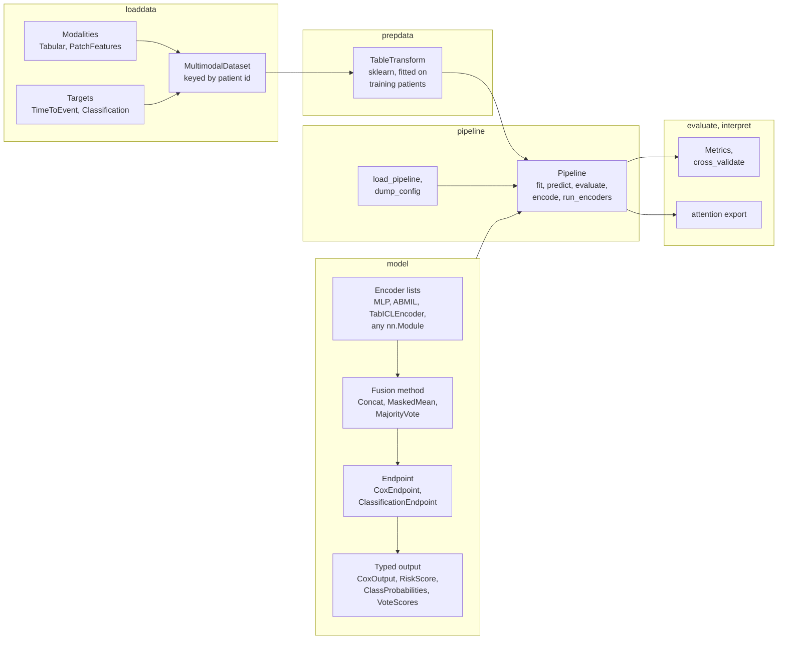

# kalecancer architecture

There is **one estimator**, `Pipeline`. It takes a model, transforms for each modality and training settings, and
behaves the same for every model and target. A model is built from encoders for each modality, a fusion method and an
endpoint; a new combination of modalities is a different dictionary, never a new class.

How to add a component is in [extending/](extending/), and why the design is as it is in [adr/](adr/).

---

## Package layout



| Subpackage | Contents |
| --- | --- |
| `loaddata` | `MultimodalDataset`, modalities, targets, `train_test_split` |
| `prepdata` | `TableTransform`: sklearn transforms for table modalities |
| `model` | encoders, fusion methods, endpoints, typed outputs, and the four models |
| `pipeline` | `Pipeline`, Lightning training, YAML configs |
| `evaluate` | metrics, `bootstrap_ci`, `cross_validate` |
| `interpret` | attention export |

---

## Data

**Patients are the identifier.** `MultimodalDataset` joins modalities and a target by patient id, and every split is
by patient, never by slide or patch ([ADR 0003](adr/0003-patient-ids.md)). Ids are strings, so read them from files
with `dtype={"patient_id": str}`, or `"01"` becomes `1`.

**Modalities** hold one kind of data per patient. `modality[ids]` gives a readable view for people, and
`modality.tensors(ids)` gives the model's tensors ([ADR 0004](adr/0004-patient-data-access.md)). There are two kinds:

| Kind | Per patient | Example |
| --- | --- | --- |
| `FixedShapeModality` | the same shape for everyone, stacked into one tensor | `Tabular`: a row of a clinical table |
| `BagModality` | a bag of instances whose size varies, batched as a list | `PatchFeatures`: pre-extracted patch features of a slide, read lazily from HDF5 |

A whole slide is therefore an ordinary modality. Feature extraction from raw slides happens before the library.

**Targets** hold the outcomes:

| Target | Contents | Endpoint |
| --- | --- | --- |
| `TimeToEvent(time, event)` | follow-up time > 0, and whether the event was observed | `CoxEndpoint` |
| `Classification(labels, classes)` | labels from an explicit, ordered class list | `ClassificationEndpoint` |

Missing outcomes raise an error: an unknown event is not a censored one.

**Tables** are prepared with `TableTransform`, a `ColumnTransformer` in which every column must be transformed or
explicitly dropped. Transforms are fitted on the training patients only.

---

## Models

| Model | Structure |
| --- | --- |
| `Unimodal` | one modality's encoders, then an endpoint |
| `EarlyFusion` | fuse the raw vector modalities, then one encoder list, then an endpoint |
| `IntermediateFusion` | encoders per modality, then a fusion method, then an endpoint |
| `LateFusion` | branch models trained jointly, then a fusion method of their outputs, then a fused endpoint (or `None`) |

Choosing a fusion strategy changes the model, not the encoders, endpoints or `Pipeline`:

```python
intermediate = IntermediateFusion(
    encoders={
        "clinical": [MLP(in_dim=12, hidden_dims=[64], out_dim=64, dropout=0.1)],
        "wsi": [ABMIL(in_dim=1024, hidden_dim=256, attention_dim=128, dropout=0.25), nn.Linear(256, 64)],
    },
    fusion=Concat(),
    endpoint=CoxEndpoint(nn.Linear(128, 1, bias=False), ties="efron"),
)

def classifier(d):
    return ClassificationEndpoint(nn.Linear(d, 2), nn.CrossEntropyLoss())

late = LateFusion(
    branches={
        "clinical": Unimodal("clinical", [MLP(12, [64], 64, 0.1)], classifier(64)),
        "wsi": Unimodal("wsi", [ABMIL(1024, 256, 128, 0.25), nn.Linear(256, 64)], classifier(64)),
    },
    fusion=MaskedMean(),
    endpoint=ClassificationEndpoint(None, nn.CrossEntropyLoss()),
)
```

Runnable versions are in [examples/hancock/](../examples/hancock/).

### Encoders

An encoder is any `nn.Module`. Each modality's encoders run in order in an `EncoderList`, which must end in one
embedding vector per patient. Available so far: `MLP`, `ABMIL` (attention pooling over a bag of patches, which reports
its attention), `TabICLEncoder` (a pretrained tabular encoder), or any `nn.Module` such as `nn.Linear`. A
`FittedEncoder`, such as `TabICLEncoder`, is fitted on the training patients before training starts, and may only be
the first encoder.

Nothing declares widths. Instead, `fit` first runs the model on a few training patients (the **dry run**), so a wrong
width, input or loss fails before training starts, with an error naming the encoder or head that raised it.

### Fusion

| Method | Stages | Combines | Patients missing a modality |
| --- | --- | --- | --- |
| `Concat` | early, intermediate | vectors, concatenated | not allowed |
| `MaskedMean` | early, intermediate, late | vectors, or the branches' risk scores or logits, averaged over those present | allowed, except for risk scores |
| `MajorityVote` | late | the branches' class votes | allowed |

Early and intermediate fusion combine tensors (`TensorFusion`); late fusion combines the branches' typed outputs
(`OutputFusion`). A method for the wrong stage fails when the model is built. Risk scores can't be averaged over
patients with different branches, because each branch's scores have their own offset.

### Missing modalities

Real cohorts rarely have every modality for every patient, so every model handles absence the same way:

1. Encoders run **only on the patients who have the modality**.
2. Fusion **selects** the patients it can combine, rather than multiplying by a mask, which would spread NaN through
   the gradients.
3. Patients the model can't predict for get NaN and are marked undefined.

Absent modalities are never zero-padded or imputed. `fit` checks up front that the fusion method can handle the
missing patterns in the data.

### Endpoints and outputs

An **endpoint** owns everything specific to what is predicted: the head (any `nn.Module`), the loss, the target check,
and state fitted after training ([ADR 0005](adr/0005-endpoint-architecture.md)).

- **`CoxEndpoint(head, ties)`** trains log-hazards with the Cox partial likelihood. After training it fits a Breslow
  baseline on the training patients, which gives survival curves.
- **`ClassificationEndpoint(head, loss_fn)`** trains logits with any torch loss, such as `nn.CrossEntropyLoss()`.

A model returns a **typed output**, whose type says what the prediction means. Fusion methods, metrics and the
`predict_*` methods check this type, so a mismatch fails before training instead of after it.

| Output | Means | Produced by |
| --- | --- | --- |
| `CoxOutput` | log-hazards, which give survival curves once the baseline is fitted | `CoxEndpoint` |
| `RiskScore` | risk scores whose ranking within one model is all that is meaningful | `MaskedMean` over Cox branches, without a fused endpoint |
| `ClassProbabilities` | class probabilities | `ClassificationEndpoint`, `MaskedMean` over classification branches |
| `VoteScores` | vote shares that rank patients but aren't probabilities | `MajorityVote` |

In `LateFusion` the fused endpoint trains the combined prediction. The loss is

```text
fused loss + branch_weight × (sum of the branch losses) + the fusion method's regulariser
```

The branch losses keep each branch useful on its own. Most fusion methods add no regulariser.

---

## Pipeline

`Pipeline` is a scikit-learn estimator over a `MultimodalDataset`, and trains with Lightning. `fit`:

1. checks the model, endpoint and early-stopping metric against the data;
2. carves validation patients out of the training patients;
3. fits the transforms, then any `FittedEncoder`, on the training patients;
4. runs the dry run;
5. trains a copy of the model, optionally early-stopping on a validation metric;
6. fits the endpoints' state, such as the Breslow baseline, on the training patients only.

Predictions come from `predict` (a DataFrame), `predict_proba`, `predict_survival_function(data, times)` and
`predict_output` (the typed output). In late fusion each takes `branch=` for one branch's own prediction. `evaluate`
scores a dataset, and `encode` and `run_encoders` give access to a modality's embeddings and encoders.

### Leakage guards

The pipeline is built so a leak fails loudly rather than quietly inflating a score:

- `fit` trains a **copy**, and refuses a model that already carries trained weights, so no fold starts from weights
  trained on other patients.
- Transforms, the validation split, fitted encoders, the Breslow baseline and the censoring distribution of IPCW
  metrics all use the training patients only.
- `evaluate` refuses patients used in `fit` unless `allow_seen=True`, and `cross_validate` checks every fold.
- `PatchFeatures` refuses a file listed more than once, so a split can't put the same input on both sides.

### Configuration

A pipeline can be written as YAML, read with `load_pipeline` and written with `dump_config`. This relies on every
component storing each `__init__` argument under its own name.

---

## Evaluation

A metric scores a typed output against the target, matched by patient id. Each declares the output type it needs, so
a mismatched metric fails before training or prediction.

| Metric | Needs | From |
| --- | --- | --- |
| `HarrellC`, `UnoC(tau)`, `TimeDependentAUC(time)` | risk scores | TorchSurv |
| `IntegratedBrier(times)` | survival curves | TorchSurv |
| `AUROC(positive_class)`, `BalancedAccuracy` | class scores | scikit-learn |

`bootstrap_ci` gives confidence intervals. `cross_validate` fits a clone of the pipeline on each fold and reports
scores per fold. They are **not pooled**, because Cox log-hazards have an offset that differs between folds.

---

## Interpretability

`kalecancer.interpret.attention` returns the attention weight of each patch, joined with its coordinates, so weights
can be mapped back onto slides. Attention shows what the pooling step relied on, not causal importance. Feature
attribution and modality ablation are future work.

---

## Design decisions

| Decision | Reasoning |
| --- | --- |
| One `Pipeline`, no per-modality or per-endpoint trainers | A bag of patches is an ordinary modality and an endpoint decides what is predicted, so the trainer never changes. |
| An endpoint owns the head, loss, target check and fitted state | A new endpoint costs an endpoint and a target, not a trainer, and the head can be any `nn.Module`. |
| Models return typed outputs | Fusion, metrics and predictions check what a prediction means by type, not by column names. |
| Encoders run on present patients, fusion selects rows | Masking or zero-filling spreads NaN through gradients; selecting rows keeps them finite. |
| Check each rule as soon as its information exists | Mistakes surface when the model is built, when `fit` starts or in the dry run, never mid-training. |
| Orchestration lives in `examples/` | Choosing splits and writing a report are experiment concerns; the library supplies pieces to compose. |
